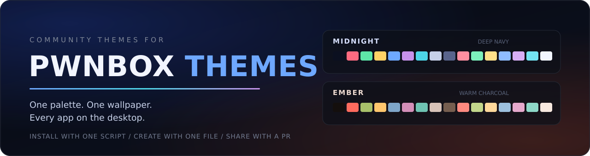
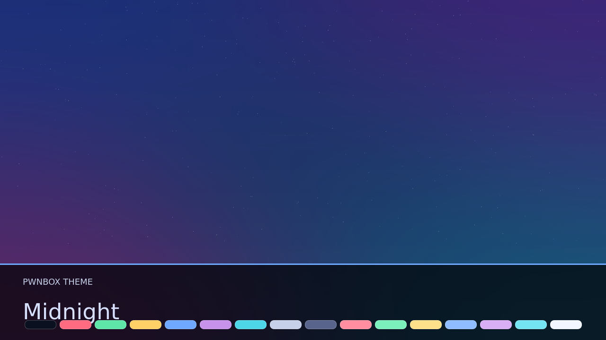
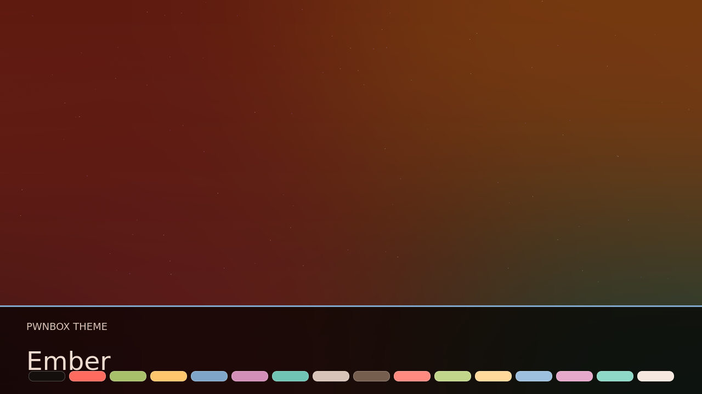

<h1 align="center">PWNBOX THEMES</h1>

<p align="center">
  
</p>

<p align="center">
  Community theme packages for <a href="https://github.com/kernelstub/Pwnbox">Pwnbox</a>:
  one fixed 16-colour palette and one wallpaper, applied across the desktop,
  terminal, editors, browser and the apps that support live theming.
</p>

---

## Table of contents

- [Themes](#themes)
- [Install a theme](#install-a-theme)
- [Create a theme](#create-a-theme)
- [Theme format](#theme-format)
- [Validate, preview, submit](#validate-preview-submit)
- [Documentation](#documentation)
- [Community](#community)
- [Author](#author)
- [License](#license)

---

## Themes

Pwnbox already ships its own themes (`Pwnbox`, `Monochrome`, `Amoled`,
`Beach`, `Catppuccin`, `Compose`, `Gruvbox`, `Nord`). This repository is for
community additions.

The format is the same as Pwnbox's `dotfiles/themes/` packages and is tested
against the current `main` branch. Every theme is a self-contained folder
under `themes/`:

| Preview | Theme | Install |
| --- | --- | --- |
| <a href="themes/midnight"></a> | **Midnight**<br>Deep navy with cyan and magenta accents.<br><sub>by [@kernelstub](https://github.com/kernelstub)</sub> | `./scripts/install-theme.sh midnight` |
| <a href="themes/ember"></a> | **Ember**<br>Warm charcoal with ember orange and amber accents.<br><sub>by [@kernelstub](https://github.com/kernelstub)</sub> | `./scripts/install-theme.sh ember` |
| <a href="docs/usage/create.md">+ Add your theme</a> | **Your theme here**<br>Build it, validate it, open a PR.<br><sub>see [docs/usage/create.md](docs/usage/create.md)</sub> | — |

Previews are generated palette cards. A real screenshot of your Pwnbox
desktop is also welcome as `preview.png`.

---

## Install a theme

Requirements: a working Pwnbox checkout (the directory with `flake.nix`) and
a user that can rebuild the system.

```bash
git clone https://github.com/kernelstub/Pwnbox-Themes.git
cd Pwnbox-Themes

# install and activate (the script finds ~/pwnbox automatically)
./scripts/install-theme.sh midnight

# or point it at your checkout explicitly
./scripts/install-theme.sh midnight --flake ~/src/Pwnbox
```

The installer validates the theme, copies only `theme.conf` and the wallpaper
into `dotfiles/themes/<name>`, stages them with `git add`, and runs
`./scripts/install.sh switch`.

Then select it:

```text
ALT + S -> THEME -> Custom -> Midnight
```

Or from a terminal:

```bash
pwnbox-theme custom
```

Useful commands:

```bash
./scripts/install-theme.sh --list   # list the themes in this repository
./scripts/install-theme.sh midnight --no-rebuild
./scripts/install-theme.sh midnight --force   # update an installed theme
```

Manual install, updating and uninstalling are covered in
[docs/setup/install.md](docs/setup/install.md).

> Themes are part of the Pwnbox flake. The flake only sees files tracked by
> git, so a copied theme must be `git add`ed and the system rebuilt before it
> appears in `ALT + S`.

The validator checks structure and palette rules, not provenance or taste.
Review a theme's `README.md` and preview before installing it.

---

## Create a theme

There is nothing to compile. A theme is data: a `theme.conf` palette and a
wallpaper. Start from the template:

```bash
cp -r themes/_template themes/aurora
$EDITOR themes/aurora/theme.conf

# add a 16:9 wallpaper (PNG or JPEG is safest)
cp ~/Pictures/aurora.png themes/aurora/wallpaper.png

# build a preview card (or drop in a real screenshot)
./scripts/render-preview.sh aurora

# check it, then install it into your Pwnbox checkout
python3 scripts/validate-theme.py --theme themes/aurora --strict
./scripts/install-theme.sh aurora --flake ~/pwnbox
```

What a theme should look like:

- A folder `themes/<name>/` with a unique, lowercase, hyphenated name
  (`aurora`, `solar-flare`, `deep-space`).
- A `theme.conf` with `name`, `wallpaper`, `background`, `foreground` and the
  complete `color0` ... `color15` ANSI palette.
- Six-digit hex colours only: `#RRGGBB`. Pwnbox does not accept `#RGB`,
  named colours, `rgb()` or eight-digit hex.
- A wallpaper in the same folder, 16:9, 2560x1440 recommended, at least
  1920x1080. PNG or JPEG is safest; WebP also works.
- A `preview.png`, 16:9, 1280x720 recommended, with no personal information
  in it.
- Theme data only. No scripts, binaries, symlinks, downloads or absolute
  paths.
- A wallpaper you have the right to redistribute. Put the author and licence
  in the theme's `README.md`.

The full walkthrough is in [docs/usage/create.md](docs/usage/create.md). The
exact file rules are in [docs/reference/theme-format.md](docs/reference/theme-format.md).

---

## Theme format

```text
themes/midnight/
├── theme.conf      # required: palette (INI-style key = value)
├── wallpaper.png   # required: the theme wallpaper
├── preview.png     # required for this repository: gallery image
└── README.md       # optional: author, licence, notes
```

A complete `theme.conf`:

```ini
name = Aurora
wallpaper = wallpaper.png

background = #0b1020
foreground = #d7e0ff
cursor = #7de2ff

color0 = #0b1020
color1 = #ff6b81
color2 = #5ee6a8
color3 = #ffd166
color4 = #6ea8ff
color5 = #c792ea
color6 = #4dd6e8
color7 = #c6d0e8
color8 = #3b4468
color9 = #ff8fa0
color10 = #7cf0bc
color11 = #ffe08a
color12 = #8fbcff
color13 = #d8aef5
color14 = #74e4f2
color15 = #f2f6ff
```

| Key | Required | Meaning |
| --- | --- | --- |
| `name` | yes | Label shown in the picker. Defaults to the folder name. |
| `wallpaper` | yes | Image in the theme folder, relative to it. |
| `background` | yes | Window and terminal background. |
| `foreground` | yes | Main text colour. |
| `cursor` | no | Text cursor. Defaults to `foreground`. |
| `color0` ... `color15` | yes | The 16-colour ANSI palette. |

Pwnbox falls back to its Monochrome palette for any missing colour, but themes
in this repository must ship the complete palette so they look the same for
everyone. See the [format reference](docs/reference/theme-format.md) for the
ANSI colour roles, fallback behaviour and validation rules.

---

## Validate, preview, submit

```bash
# validate every theme in the repository
python3 scripts/validate-theme.py

# exactly what CI runs (warnings are errors)
python3 scripts/validate-theme.py --strict

# validate one theme
python3 scripts/validate-theme.py --theme themes/aurora --strict

# regenerate a preview card
./scripts/render-preview.sh aurora

# list installable themes
./scripts/install-theme.sh --list
```

To submit a theme:

1. Fork the repository and create a branch (`theme/aurora`).
2. Add `themes/aurora/` with `theme.conf`, wallpaper, `preview.png` and a
   `README.md` that credits the author and the wallpaper licence.
3. Add a row to the [Themes](#themes) table in this README.
4. Run `python3 scripts/validate-theme.py --strict`.
5. Open a pull request using the template.

Review criteria, licensing and the full submission flow are in
[docs/development/submit.md](docs/development/submit.md).

---

## Documentation

| Document | What it covers |
| --- | --- |
| [Install](docs/setup/install.md) | Installer options, manual install, update, uninstall |
| [Create a theme](docs/usage/create.md) | Palette design, wallpaper, preview, testing, checklist |
| [Theme format](docs/reference/theme-format.md) | Exact `theme.conf` grammar, ANSI roles, file rules |
| [Troubleshooting](docs/reference/troubleshooting.md) | Theme does not appear, wrong colours, stale previews |
| [Architecture](docs/development/architecture.md) | How a theme moves from this repo into Pwnbox |
| [Submit a theme](docs/development/submit.md) | Fork, validation, gallery row, review criteria |
| [Contributing](CONTRIBUTING.md) | Repository layout, style, testing |
| [Security policy](SECURITY.md) | Reporting malicious or unsafe themes privately |
| [Code of conduct](CODE_OF_CONDUCT.md) | Community expectations |
| [Docs index](docs/README.md) | All documentation at a glance |

Pwnbox's own documentation for the theme engine is in
[Pwnbox docs/usage/themes.md](https://github.com/kernelstub/Pwnbox/blob/main/docs/usage/themes.md)
and [dotfiles/themes/README.md](https://github.com/kernelstub/Pwnbox/blob/main/dotfiles/themes/README.md).

---

## Community

- [Contributing](CONTRIBUTING.md) — add a theme, fix docs, improve tooling.
- [Code of conduct](CODE_OF_CONDUCT.md) — be respectful, credit your sources.
- [Security policy](SECURITY.md) — report unsafe theme packages privately.
- [Pwnbox issues](https://github.com/kernelstub/Pwnbox/issues) — bugs in
  Pwnbox itself, not in a community theme.

Issues and pull requests are welcome. One theme per pull request, and keep
changes focused.

---

## Author

Created by **Prepakis Georgios** (aka **kernelstub**).

- X / Twitter: [x.com/kernelstub](https://x.com/kernelstub)
- Email: [kern@skuntir.com](mailto:kern@skuntir.com)

---

## License

The repository is released into the public domain under the
[Unlicense](LICENSE). Do anything you want with it.

Wallpapers and previews may carry their own licence; each theme's `README.md`
states the licence for its artwork. By contributing, you agree to release your
theme configuration under the Unlicense and confirm that you have the right to
redistribute the wallpaper.
