<h1 align="center">PWNBOX THEMES</h1>

<p align="center">
  
</p>


<p align="center">
  Community theme packages for <a href="https://github.com/kernelstub/Pwnbox">Pwnbox</a>:
  one fixed 16-colour palette and one wallpaper, applied across the desktop,
  terminal, editors, browser and the apps that support live theming.
</p>

---

## Themes

Pwnbox ships its own themes; this repository is for community additions. Every
contributed theme is a self-contained folder under `themes/` and gets a row in
this gallery. Pick one below and copy it into your Pwnbox dotfiles.

| Preview | Theme | Install |
| --- | --- | --- |
| <a href="themes/amoled">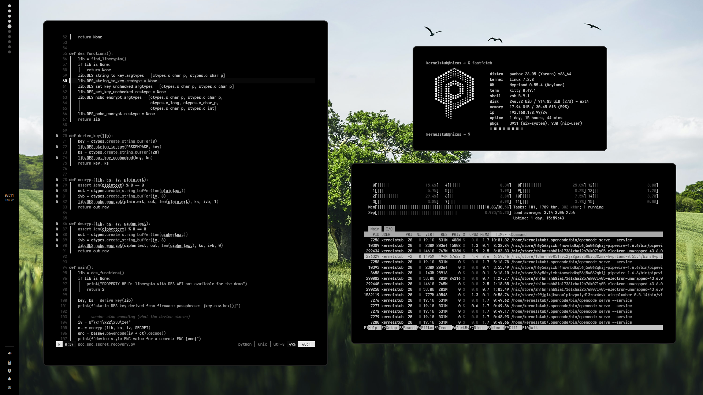</a> | **Amoled**<br>Pure-black grayscale palette for OLED displays. | copy to `dotfiles/themes/amoled` |
| <a href="themes/beach">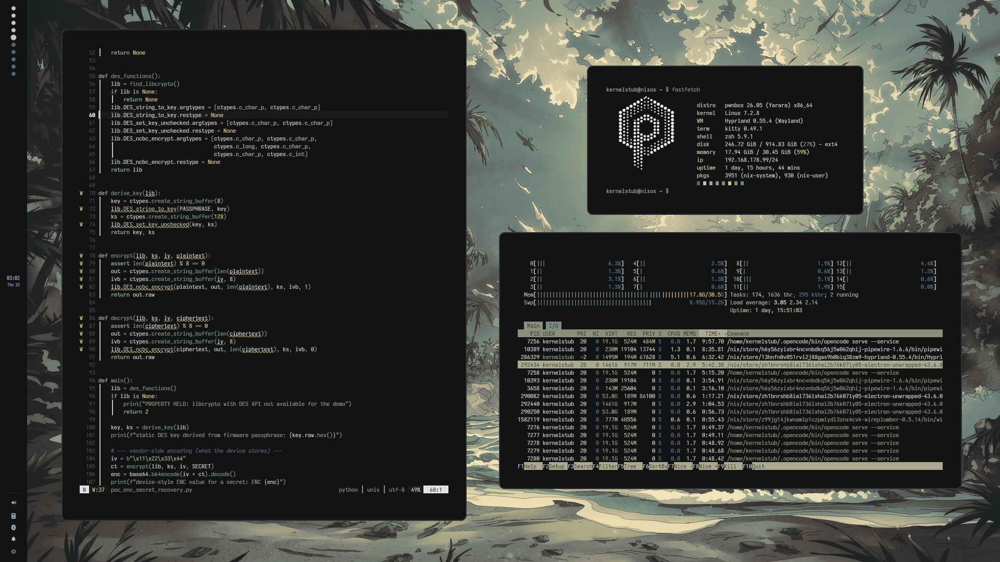</a> | **Beach**<br>Muted sand and sea-green tones. | copy to `dotfiles/themes/beach` |
| <a href="themes/catppuccin">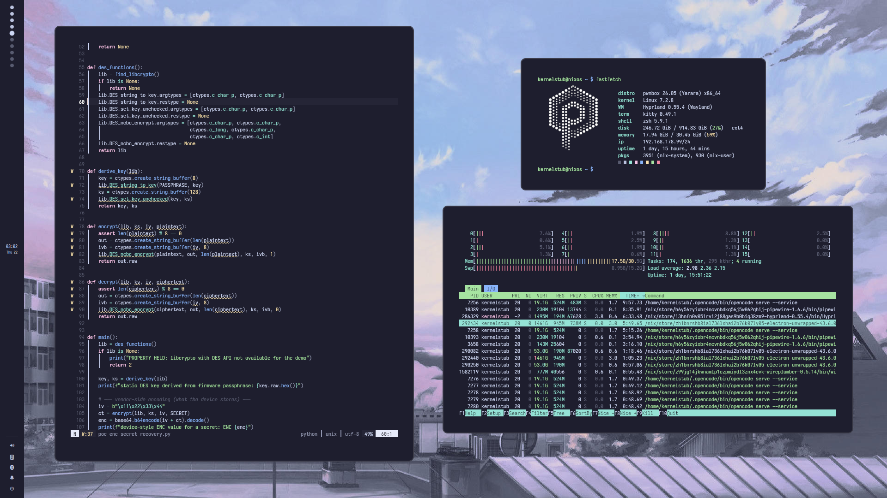</a> | **Catppuccin Mocha**<br>The popular Catppuccin Mocha palette. | copy to `dotfiles/themes/catppuccin` |
| <a href="themes/compose">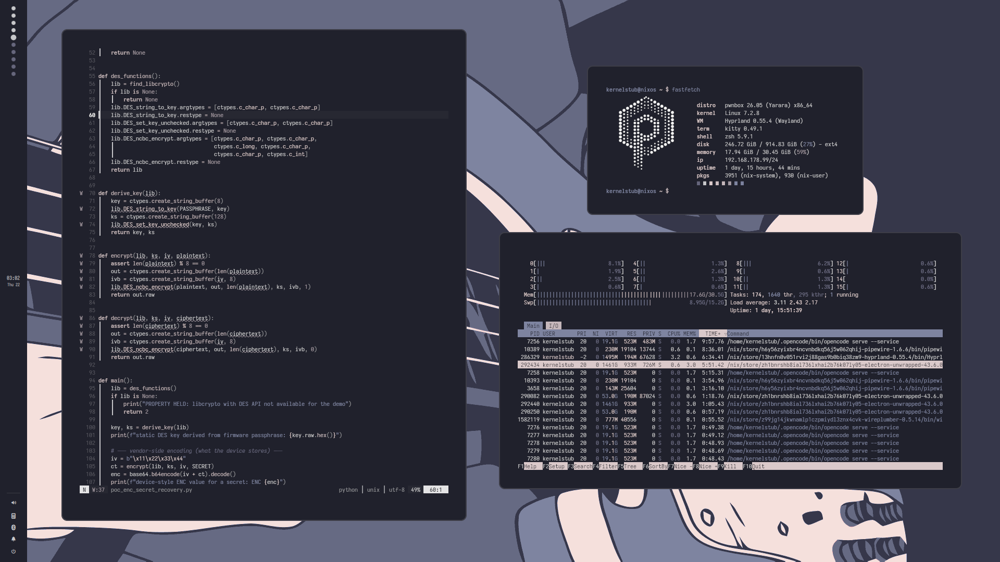</a> | **Compose**<br>Soft lavender and mauve tones. | copy to `dotfiles/themes/compose` |
| <a href="themes/decay">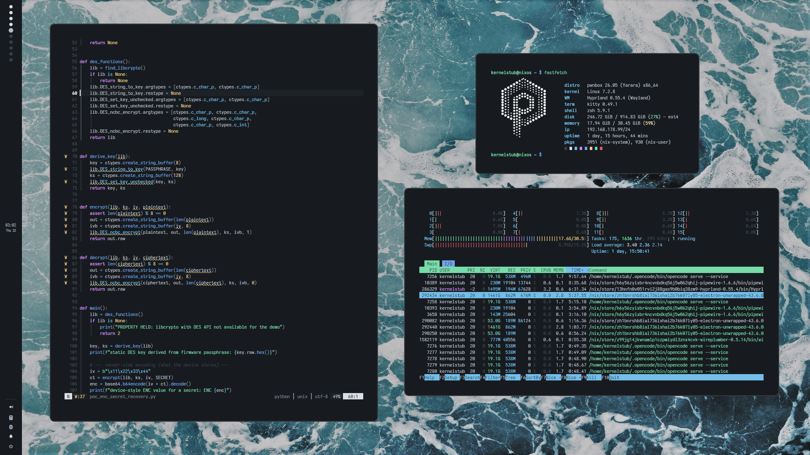</a> | **Decay**<br>Deep blue-black with vivid pastel accents. | copy to `dotfiles/themes/decay` |
| <a href="themes/espresso">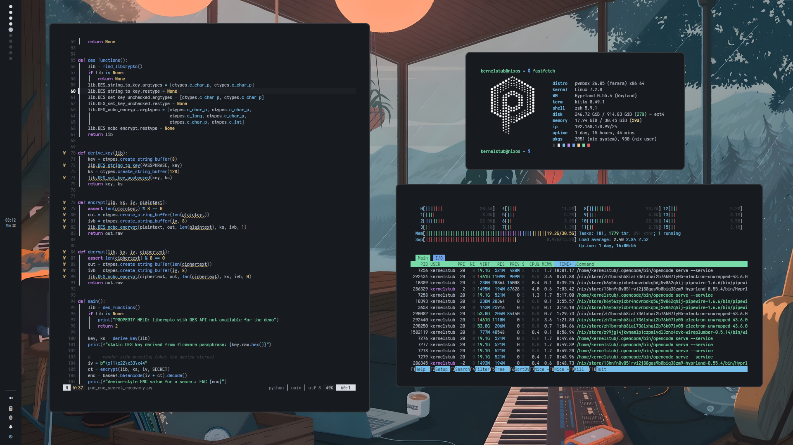</a> | **Espresso**<br>Dark coffee tones with warm pastel accents. | copy to `dotfiles/themes/espresso` |
| <a href="themes/gruvbox">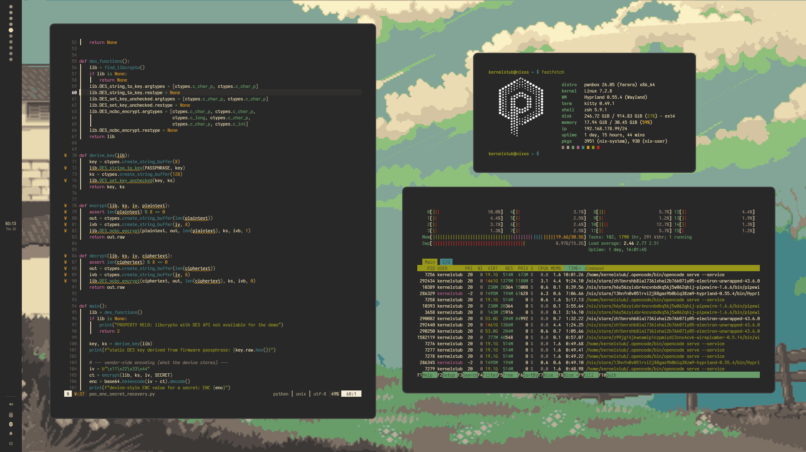</a> | **Gruvbox**<br>The classic Gruvbox Dark palette. | copy to `dotfiles/themes/gruvbox` |
| <a href="themes/monochrome">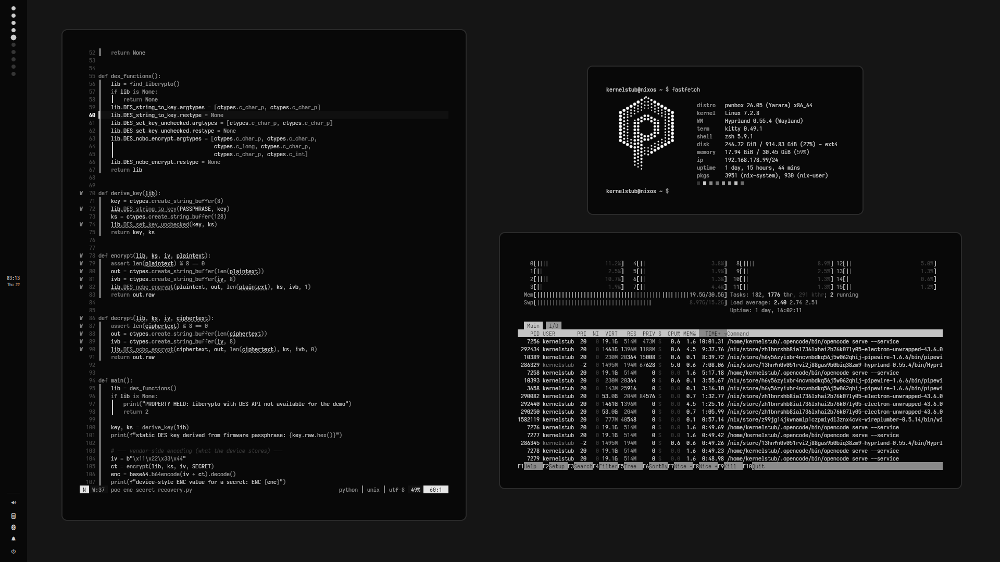</a> | **Monochrome**<br>High-contrast black-and-white palette. | copy to `dotfiles/themes/monochrome` |
| <a href="themes/natura">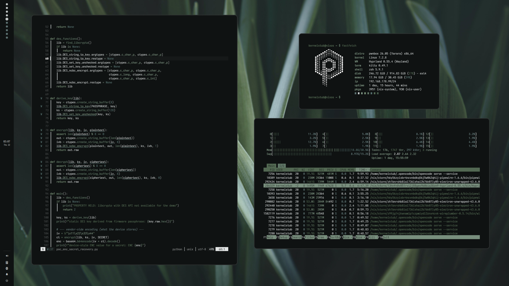</a> | **Natura**<br>Forest greens on near-black. | copy to `dotfiles/themes/natura` |
| <a href="themes/nord">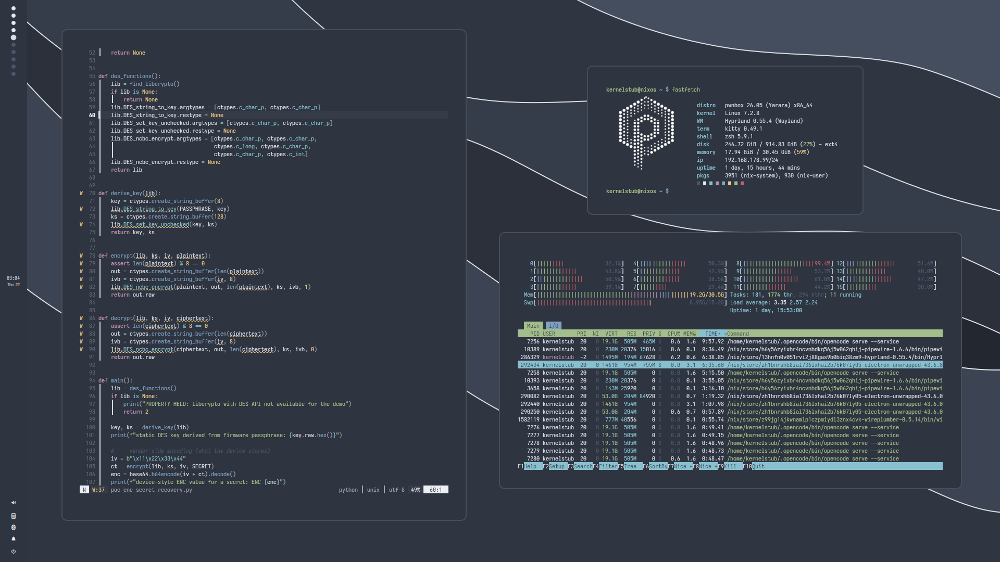</a> | **Nord**<br>The arctic, blue-tinted Nord palette. | copy to `dotfiles/themes/nord` |
| <a href="themes/pwnbox">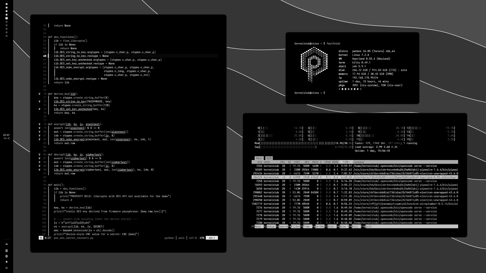</a> | **Pwnbox**<br>Pwnbox's default monochrome palette. | copy to `dotfiles/themes/pwnbox` |
| <a href="themes/sakura">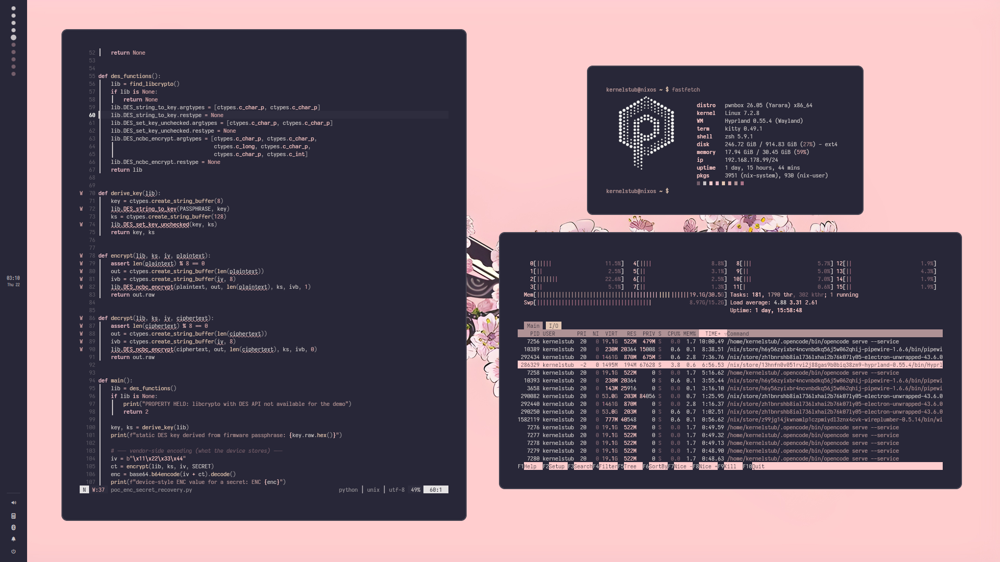</a> | **Sakura**<br>Dusty pink and cream blossom tones. | copy to `dotfiles/themes/sakura` |
| <a href="docs/usage/create.md">+ Add your theme</a> | **Your theme here**<br>Build it, validate it, open a PR. | — |

The [`themes/_template/`](themes/_template/) package is the starting point for
your own theme.

---

## Quick start

**Use a theme** from the gallery:

```bash
cp -r themes/amoled ~/pwnbox/dotfiles/themes/

cd ~/pwnbox
git add dotfiles/themes/amoled
upd
```

Then select it with `ALT + S -> THEME -> Custom`, or run `pwnbox-theme custom`.
Replace `amoled` with whichever theme folder you copied. See
[docs/setup/install.md](docs/setup/install.md) for updating and uninstalling.

**Create a theme:**

```bash
cp -r themes/_template themes/aurora
$EDITOR themes/aurora/theme.conf
cp ~/Pictures/aurora.png themes/aurora/wallpaper.png

# add a 16:9 screenshot as themes/aurora/preview.png
python3 scripts/validate-theme.py --theme themes/aurora --strict
```

Then copy it into Pwnbox with the commands above. The full walkthrough is in
[docs/usage/create.md](docs/usage/create.md); the file rules are in
[docs/reference/theme-format.md](docs/reference/theme-format.md).

---

## Documentation

| Document | What it covers |
| --- | --- |
| [Install](docs/setup/install.md) | Copy, update and uninstall a theme |
| [Create a theme](docs/usage/create.md) | Palette, wallpaper, preview, testing |
| [Theme format](docs/reference/theme-format.md) | Keys, ANSI roles, file rules |
| [Troubleshooting](docs/reference/troubleshooting.md) | Theme does not appear, wrong colours, stale previews |
| [Submit a theme](docs/development/submit.md) | Pull request flow and review criteria |
| [Architecture](docs/development/architecture.md) | How a theme moves from this repo into Pwnbox |
| [Docs index](docs/README.md) | All documentation at a glance |

Pwnbox's own theme documentation lives in
[docs/usage/themes.md](https://github.com/kernelstub/Pwnbox/blob/main/docs/usage/themes.md).

---

## Community

- [Contributing](CONTRIBUTING.md) — add a theme, fix docs, improve the validator.
- [Code of conduct](CODE_OF_CONDUCT.md) — be respectful, credit your sources.
- [Security policy](SECURITY.md) — report unsafe theme packages privately.
- [Pwnbox issues](https://github.com/kernelstub/Pwnbox/issues) — bugs in Pwnbox itself.

Issues and pull requests are welcome. One theme per pull request.

---

## Author

Created by **Prepakis Georgios** (aka **kernelstub**).

- X / Twitter: [x.com/kernelstub](https://x.com/kernelstub)
- Email: [kern@skuntir.com](mailto:kern@skuntir.com)

---

## License

The repository is released into the public domain under the
[Unlicense](LICENSE).

Wallpapers and previews may carry their own licence; each theme's `README.md`
states the licence for its artwork.
